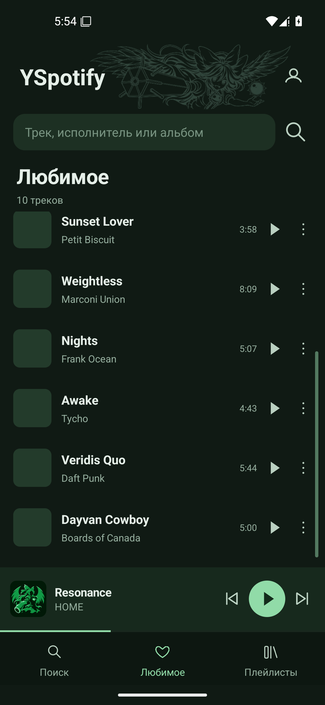
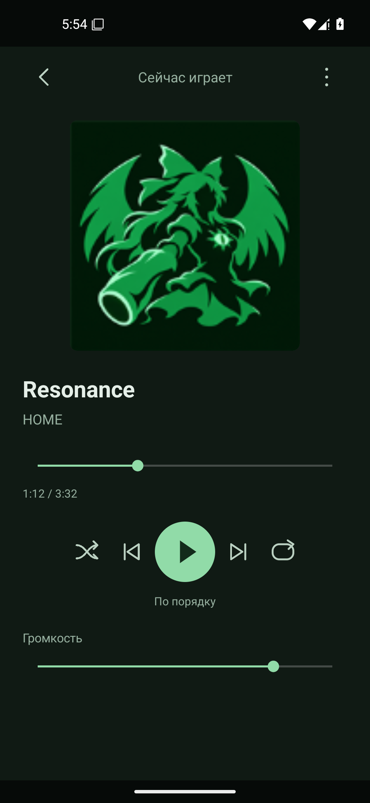

# YSpotify для Android

Нативный интерфейс Android и фоновый плеер Media3. Для входа используется отдельный WebView приложения; воспроизведение работает через Android MediaDrm. Сеанс хранится с AES-GCM и ключом Android Keystore. Пароли приложение не сохраняет.

Минимальная версия — Android8.0. Перенесены поиск, избранное, плейлисты, обложки, пауза, стрелки, громкость, перемешивание, повтор и управление из уведомления. Интерфейс меняет компоновку при повороте экрана.

Версия 0.1.0 выпускается как предварительная сборка. Вход в настоящий аккаунт и воспроизведение Spotify через Widevine на физическом телефоне ещё не проверены: устройство не подключено. Вход через Google в мобильном WebView также не подтверждён. Для входа нужен работающий Android System WebView.

Скачать: [подписанный APK и исходники](https://github.com/Yroktan/YSpotify/releases/tag/v0.1.0-android). APK предназначен для проверки; стабильная Windows-версия публикуется отдельно.

## Интерфейс

Снимки нативного приложения на Android 15 используют демонстрационный список. Обложка плеера в демонстрации — значок YSpotify.

 

[Горизонтальная ориентация](design/landscape.png).

Крупный шрифт: [список](design/portrait-large-text.png), [плеер](design/player-large-text.png), [горизонтальная ориентация](design/landscape-large-text.png).

## Сборка

Нужны JDK17 и Android SDK36 с Build Tools35.0.0. Укажи JAVA_HOME и ANDROID_HOME.

```sh
chmod +x gradlew
./gradlew :app:assembleDebug :app:testDebugUnitTest :app:lintDebug
```

Из корня проекта на Windows:

```powershell
powershell -NoProfile -ExecutionPolicy Bypass -File .\build-android.ps1
```

Скрипт создаёт постоянный ключ подписи в %LOCALAPPDATA%/YSpotifyBuild. Пароль защищён Windows DPAPI. Ключ и файл android-keypass.bin нужны для последующих обновлений; их нельзя добавлять в Git или передавать получателям APK.

Отпечаток сертификата официальной сборки, SHA-256:

```text
1f007cd831c17320ed7dbeea41915c93d0bb05163eac41d7b72fea19abe9bec1
```

Изменённый APK с другим сертификатом не сможет обновить установленную сборку с этим ключом.

## Проверки

Шесть JVM-тестов проверяют полноту страниц, недоступные песни, смену размера списка, повторяющиеся треки и пустую библиотеку. Инструментальные тесты проверяют границы интерфейса при повороте, запуск без аккаунта, шифрование и восстановление сеанса, выход во время обновления входа. Отдельный тест воспроизводит медленный тестовый WAV-поток дольше таймаута API; он не проверяет лицензию Spotify. CI повторяет проверки на узком экране с увеличенным шрифтом.

Фактические результаты, размер и контрольная сумма APK находятся в [отчёте](../validation/android-check.json). Снимки и измерение памяти при запуске доступны в артефактах [Android CI](https://github.com/Yroktan/YSpotify/actions/workflows/android.yml). Замеры эмулятора без аккаунта не являются замерами памяти при музыке Spotify на телефоне.
